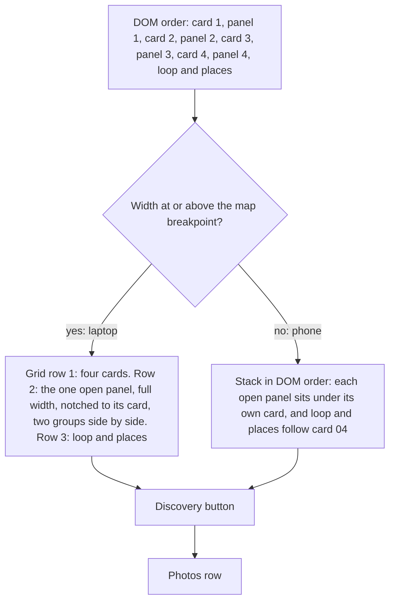
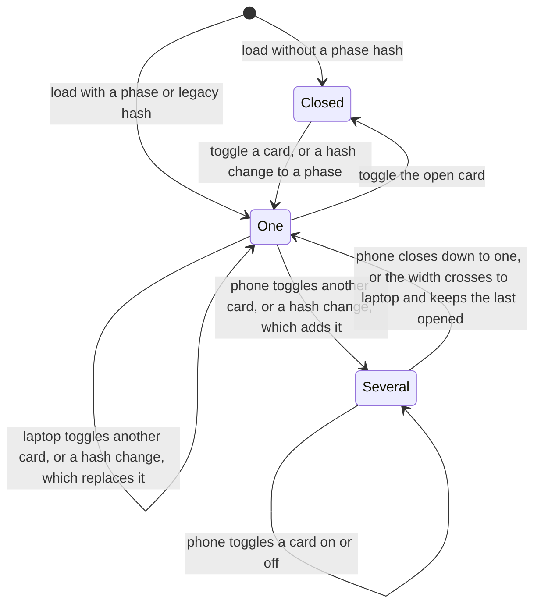

# Framework Map on /culture - Plan

## Goal Capsule

- **Objective:** A visitor to dreamscope.win can see the approved Dreamscope Framework, Discover first, as a map on /culture and open any phase on a laptop or a phone, and no page on the site still teaches the old Inspire-first version or a line Joe has banned.
- **Means:** v3 page 1 rebuilt in HTML as "the map that opens", each card opening its v3 page 2 detail (KTD1, KTD3), plus copy fixes in five other files and a rebuilt culture brief PDF.
- **Authority:** Joe's decisions under Key Decisions, then the canvas "DS Framework 2.0" (artboards `V3Main.dc.html`, `V3Inside.dc.html`) for every word of framework copy, then `DS Framework\_overview.md` in DS Local for method canon, then this plan, then the two design consults.
- **Stop and ask Joe when:** the canvas wording differs from `v3-text.md` at build time, a fix needs copy that neither v3, the canon nor a unit step already calls for, the PDF generator's overflow guard fires, a touched file or `main` carries changes that aren't this plan's, or any step would commit or push before his go.
- **Execution profile:** edit in the shared checkout on `main` without switching branches or stashing, since other sessions use this working copy; the repo has no test runner, so proof is the build, a stale-copy sweep and browser checks at 1440, 1366 and 390 wide.
- **Tail ownership:** `/ce-work` builds and verifies locally, `/ce-code-review` reviews the diff, Joe previews and says go, then the shared-copy guards, one commit by explicit paths, a push to `main` (a production deploy), a live check, the sendable PDF copy and `/pm sync`.

---

## Product Contract

### Summary

Rebuild the framework section of /culture as v3's map that opens, and fix the stale culture copy on the home page, the culture brief and its PDF, two articles and the /brief AI card.

### Problem Frame

Joe approved v3 of the framework on 23 Oct 2026: Discover goes first, the culture elements follow the canon chain, and the seven places are the implementation plan built in Build or Refresh.
The live site still teaches the old version: Inspire first on /culture, the home page, the culture brief and the four-phase article, a chain that ends on the North Star, a values count, "quick wins: easiest first", the banned "in the building" and "executive floor" metaphors, "Fix what was built wrong", and "9 yrs" right under a hero that says ten.
The /culture framework section also runs about six laptop screens and more than ten phone screens.
Joe sends the v3 PDF privately to a few people and wants a public version that a link like /culture#implement can stand in for.

### Key Decisions

- **The map that opens, at /culture#framework.** (session-settled: user-directed — chosen over a sticky map beside a scrolling story and over a map on its own page: only the map shows the whole shape closed and opens depth on request.) Governs R1, R2, R3.
- **The site's Cool palette, never the deck gold.** (session-settled: user-directed — chosen over reusing the deck look: the site's identity is canonical for the web.) Governs R2.
- **A laptop gets one full-width panel under the map; phone cards stack and open in place.** (session-settled: user-approved — chosen over the other consult options, which left the phone with today's long scroll under a sticky bar: both consults proposed it and Joe assented.) Governs R4, R5.
- **Every phase has its own link.** (session-settled: user-approved — chosen over sending the private PDF: a link to one phase replaces most PDF sends, both consults proposed it and Joe assented.) Governs R6.
- **The map replaces the intro, the stepper, the four phase sections and the Playbook section, and the three photos become one row after it.** (session-settled: user-directed — chosen over keeping the Playbook section and over photos inside the panels.) Governs R1, R7, R8.
- **The framework PDF stays private.** (session-settled: user-approved — chosen over a download: page 2 can't be read on a phone, and a download competes with the discovery form.) Governs R9.
- **The leader profile line shows as standard.** (session-settled: user-directed — chosen over marking it a priced option.) Governs R3.
- **Any phase can run alone, and "Never skipped" stays as emphasis.** (session-settled: user-directed — chosen over "only Discover runs alone" and over stating the order only: Joe sells single phases, and "Never skipped" is emphasis, not a rule.) Governs R1, R12, R13, R14.
- **The survey line keeps "anonymous".** (session-settled: user-directed — chosen over dropping the word: anonymity is a big part of getting honest answers, and the anonymity sheet's mechanics, no name on any answer and nothing to join them with, are anonymity.) Governs R3.
- **"The visibility wall" is rewritten in plain words.** (session-settled: user-directed — chosen over keeping it: a wall belongs to the building-and-floor image family Joe bans.) Governs R15.
- **On a laptop the open panel sits right under the cards, above the loop and places.** (session-settled: user-directed — Joe at the preview, 26 Oct, chosen over the panel under the whole map and over landing phase links on the panel itself: a phase link then shows its card and the start of its detail together; review finding #1.) Governs R4, R6.
- **The toggle reads "More details +".** (session-settled: user-directed — Joe, 26 Oct, replacing "See inside +".) Governs R2, R3.
- **Scope Joe confirmed on 25 Oct: a discovery button under the map, the Discover panel's Culture Engine link, the /brief AI card fix, and an in-place article rewrite with no map graphic.** (session-settled: user-approved — proposed in the scoping summary with the designers' extras left out, Joe confirmed.) Governs R3, R10, R14, R15.

### Requirements

**The map on /culture**

- R1. The framework section opens with v3 page 1's header ("The Dreamscope Framework", "Culture is how your strategy gets done.", "Find out first. Everything after is built on what you found."), keeps today's line "Run as one engagement, or any single phase on its own." under it, and replaces the rest of the old intro, the stepper and the four phase sections.
- R2. The map shows v3 page 1 in the site's Cool palette: the four phase cards in order with number, name, promise and "You get" line, chevrons between them, the quarterly loop with its "Employee survey" pill and page 1 loop text, and the seven places line with its pills.
- R3. Each card opens its v3 page 2 detail word for word, minus the "You get" box the card already shows, with the existing link to /culture-engine added to Discover.
- R4. On a laptop, one phase is open at a time, in a full-width panel right under the cards that is visibly tied to its card.
- R5. On a phone, the cards stack in order, each opens in place, several can be open at once, and opening one never moves the content above it.
- R6. /culture#discover, #inspire, #build and #implement open that phase and bring it into view, whether loaded directly or reached from another page.
- R19. Opening or closing a phase updates the address bar to that phase's link, or to #framework when none is open, without adding a Back step.
- R7. The three phase photos sit in one row after the framework, swipeable on a phone.
- R8. The separate Culture Playbook section is gone, and Build's "You get" box carries it.
- R9. The site offers no download of the framework PDF.
- R10. A button to the discovery form sits right under the map, worded so it doesn't read as phase 01.

**Copy fixes across the site**

- R11. No page, meta description, brief, PDF or article presents the phases in the old Inspire-first order.
- R12. The home page Culture card lists the phases in v3 order and keeps "applied as one engagement or any piece in isolation".
- R13. The culture brief, page and PDF, shows the four phases in v3 order with v3 names and "You get" lines, and keeps "Start wherever it hurts", "You don't need all four" and the "Most start here" tag on Discover.
- R14. The four-phase article teaches the v3 order and its reasons, the canon chain without a values count, and no fixed order for the first places, and keeps its other paragraphs.
- R15. The banned "in the building", "executive floor" and "visibility wall" metaphors are gone from every page.
- R16. /culture says "10 yrs", not "9 yrs", and no page states a values count, says "easiest first", or calls anything but the seven places "the places".
- R17. Every changed line keeps the site guardrails: no em-dashes, "the 20 Dreamscope Factors" on first mention, verified claims only, American English, and the joes-voice skill for first-person lines.

**Release**

- R18. Nothing is committed or pushed before Joe has seen the changed pages in a local preview at laptop and phone width and said go.

### Success Criteria

- Closed, the map fits about one laptop screen at 1440x900 and about three phone screens at 390 wide.
- The stale-copy sweep in the Verification Contract finds nothing in `src/`, `scripts/` or the rebuilt PDF's text.
- A link to /culture#implement, opened cold, lands on Implement with its detail open.

### Scope Boundaries

- The canvas, the private PDF and the DS Framework files stay as they are; the 25 Oct "any phase can run alone" note in `_overview.md` is already written.
- No new article block types.
- The designers' extras stay out: live report delivery with AI Q&A, the 290-employee story in the Discover panel, a managers sentence on the map's loop, and a "Next" button in the panel.
- The hero's "Take the 15-minute discovery" and the closing CTA labels stay as they are.
- /culture-engine's own "Three phases" section describes the engine's engagement steps, not the framework, and stays.

#### Deferred to Follow-Up Work

- Rename the "discovery" form CTAs site-wide, since the word now sits near "01 Discover" (both consults flagged it for a copywriter).
- Reconcile "Listen first. Then build." in How we start with "Find out first".
- Fix the home card's detail line, which says leadership and frontline data converge "into a single playbook" (the report is Discover's, the Playbook is Build's).
- Align the eNPS mentions in the article and on /culture-engine once Joe settles whether the quarterly survey always carries the eNPS (open item 6 in `Diagram v2 - framework questions.md`).
- Fix /culture-engine's "Quarterly pulse measurement" line, since the canon says the pulse is not offered yet.
- Fix /ai-maestro's "nine years building the systems that run companies", the same stale count as "9 yrs".
- Career counts are literal text and go stale on known dates: "20 years" in April 2027 and "ten" or "10 yrs" in November 2027.
- Finish the v3 sign-off write-backs the PM notebook lists for the diagram project: the canonical-assets registry still marks the v3 artboards UNVERIFIED, and open items in `Diagram v2 - framework questions.md`, the panel's 15 gaps and the rhythm rows for `implement-sequencing.md` are still owed.
- Add `FrameworkMap` and `src/data/framework.ts` to the dreamscope-website skill's Architecture section through the plugin edit flow, and drop its stale "preview renders blank" line.
- Send a GA4 event when a phase opens, so Joe can see which phases people read (GA4 already runs on every page).
- Add a "Next" button at the foot of each laptop panel, with focus moving into the newly opened panel (the information designer's idea).
- Add a print stylesheet that opens every panel, if Joe ever wants paper from the site (the information designer's idea).

### Sources

- Copy master: the canvas https://claude.ai/artifact/Q1SZ9MTbstQYcMrdKtnb7j, artboards `V3Main.dc.html` and `V3Inside.dc.html`, read on 25 Oct and identical to `v3-text.md`.
- In DS Local: `DS Framework\Diagram v2 panel\web\` (`brief-web.md`, `consult-panel-web-designer.md`, `consult-panel-info-designer.md`, `v3-page1.png`, `v3-page2.png`, `v3-text.md`), `DS Framework\_overview.md` (the chain canon), `DS Framework\Diagram v2 - framework questions.md`.
- `src/components/Layout.tsx` scrolls to the element whose id matches the hash after every route or hash change, with `behavior: "smooth"`, and otherwise to the top.
- `src/App.tsx` puts one Suspense boundary above Layout, so a lazy page's DOM exists before Layout's scroll effect runs.
- React Router 6.30.1 (`@remix-run/router` 1.23.0) updates its location only on `popstate`, which browsers fire for in-page hash links and back or forward, never for `history.replaceState`, and it skips a re-render when the new location equals the one it holds.
- `src/components/Navbar.tsx` is a self-contained component with its own injected styles and independent per-group open state in its mobile accordion.
- `src/pages/Card.tsx` has the simplest `aria-expanded` toggle in the repo, named by its own visible text.
- `src/data/insights.ts` defines the typed block union (`InsightBlock`) the framework data mirrors.

---

## Planning Contract

### Key Technical Decisions

- KTD1. **The map is its own component with its own injected styles.** `src/components/FrameworkMap.tsx` owns markup, open state, hash sync and CSS under a `.fwm-` prefix, the way `Navbar.tsx` does, and `CulturePractice.tsx` renders it inside the existing `#framework` section. This keeps the 900-line page from growing and puts the map's state logic in one place.
- KTD2. **One copy source, `src/data/framework.ts`.** It holds the header, the line kept from the old intro, the four phases (id, number, name, promise, "You get" line, detail blocks), the loop texts and the seven places, transcribed from the canvas. Detail blocks are a small typed union in the style of `InsightBlock`: a lead line, a labeled group of term rows, numbered steps, place pills, rhythm rows and a closing note. `BriefCulture.tsx` reads names and "You get" lines from it, and the PDF script stays hand-synced because Python can't import it.
- KTD3. **One DOM order, two layouts.** The children run card 1, panel 1, card 2, panel 2, card 3, panel 3, card 4, panel 4, then the loop-and-places block. At or above the map breakpoint, CSS grid puts the cards in row 1, the open panel in row 2 across all columns and the loop-and-places block in row 3 (Joe, 26 Oct), spaced by margins rather than row-gap so the empty panel row takes no room while all are closed; below it, everything stacks in DOM order, so each panel opens in place. On a laptop the open panel sets its two labeled groups side by side, as both consults drew it: Discover's sources beside the Culture Engine rows, Build's elements beside the implementation plan, and Implement's embed group beside the rhythm, with Inspire, the closing notes and the loop text full width beneath. Closed panels carry the `hidden` attribute, so their text stays in the DOM and nothing renders twice; a `.fwm-` rule keeps hidden panels at `display: none`, because Tailwind's preflight `[hidden]` rule loses to any class that sets display.
- KTD4. **Open state is an ordered list of open phase ids, and the breakpoint picks the rule.** On a laptop, opening a phase replaces the open one; on a phone, each card toggles on its own. Crossing to laptop width with several open keeps the most recently opened. One breakpoint constant drives both the CSS media query and a `matchMedia` listener read synchronously on first render; it starts at the page's existing 900px collapse point and rises only if four cards don't fit. `useIsMobile` is not used: its 768px cut differs and it returns false on first render.
- KTD5. **The URL hash and the open state stay in step.** The initial state reads the hash at first render, so the phase is already open when `Layout.tsx` scrolls to it. Each card carries its phase id (`discover`, `inspire`, `build`, `implement`) and an empty anchor with its legacy `phase-*` id, so Layout's scroll finds old links too and legacy hashes open the same phase; cards always render, so the ids exist before any effect runs. A toggle writes the most recently opened phase still open to the address bar with `history.replaceState`, which adds no history entry and doesn't trigger Layout's scroll; closing the last open phase writes `#framework`. The call passes the existing `history.state` through, so React Router's index and key for the entry survive. Routing toggles through the router instead would fire Layout's scroll on every open and jump to the top whenever the hash emptied. Later hash changes come from the window's `hashchange` event, not the router's location, which stays a step behind after a replaced hash: a phase hash opens that phase (replacing on a laptop, adding on a phone), and `#framework` or an unknown hash closes nothing. After a cold load with a phase hash, the map re-aligns its card once fonts and the window's load event have settled, unless the visitor has scrolled, because late fonts and logos above the map can shift where Layout's scroll landed.
- KTD6. **The loop is drawn with CSS borders, not page 1's fixed-pixel SVG.** Borders stretch with the 1100px wrap and with cards opening on a phone. On a laptop the line runs from card 04 down the right edge, past any open panel, along the bottom and up into the "Employee survey" pill under card 01, drawn in three overlapping pieces (card 04, the open panel, the places); on a phone a rail climbs the right edge from the loop back to Discover.
- KTD7. **Page 2's full quarterly loop text closes the Implement panel.** The panel runs the embed group, the rhythm rows and the closing note, then the full loop text, managers sentence included, because the rhythm row says "The quarterly loop, below."; the map keeps page 1's short loop text. In both layouts the loop-and-places block follows the open Implement panel directly, so while Implement is open the map's short loop label and text are hidden and the loop reads once.
- KTD8. **Each toggle is an accessible disclosure, as in `Card.tsx` and `Navbar.tsx`.** It's a real `<button>` with `aria-expanded` and `aria-controls`, named by its visible label ("More details +" or "Close") plus visually hidden words, so it reads "More details on Discover" or "Close Discover" with no `aria-label`; the whole card is its hit area through a stretched pseudo-element. Focus stays on the button, and each panel is a region labeled by its phase name. DOM order keeps each panel right after its card for keyboard and screen-reader users, even where the laptop grid shows it lower.
- KTD9. **On a laptop, a panel opened by a click is brought into view.** The panel opens right under the card row, so a card clicked low on the screen can open it below the fold, and the click could look like it did nothing. If the panel's top lands in the bottom third of the visible area or below it, the page scrolls so the top sits about a third of the way down, instantly under reduced motion; hash-driven opens rely on the card landing (KTD5), and on a phone opening a card never scrolls.
- KTD10. **The panel has no "Next" button in this build.** The information designer proposed one, but it isn't in the scope Joe confirmed, and on a laptop it would hide its own panel and need its own focus handling, so it's a follow-up.
- KTD11. **The culture brief PDF is regenerated, never hand-edited.** `scripts/build_culture_brief_pdf.py` gets the new tile list and a highlight keyed to Discover instead of tile "02", and its overflow guard must pass. After Joe's go, the same file replaces the sendable copy in DS Local `Branding & Marketing\Generic Deck & Brief\`.
- KTD12. **Hash landings respect reduced motion across the site.** `Layout.tsx` passes `behavior: "smooth"` to its hash scroll, which overrides the page CSS, so that scroll becomes instant when the visitor prefers reduced motion; phase links make it the main way into the framework. Decided at code review (25 Oct): the cold-load fix covers every route, not only /culture, because the same late-font shift misses any hash target (for example /#contact). A cold load with a hash jumps instantly, as browsers do natively, then lands again after fonts and the load event unless the visitor has scrolled. In-app hash links keep their glide. The logo strips on / and /culture get each logo's intrinsic size (`src/data/companyLogos.ts`), so a strip keeps its height while its lazy images load: Safari before 27 has no scroll anchoring, and at 390 wide the strip used to grow 81px after the second landing.
- KTD13. **Small teal text sits only on white or warm-white.** Teal `#0C7C8A` passes WCAG AA there (about 4.8:1) but not on cream (about 4.5:1) or sand (about 4.0:1), so cards, panels and "You get" boxes that carry small teal labels use white or warm-white surfaces.

### High-Level Technical Design

Layout: one DOM order, placed two ways (KTD3, KTD4).

Open state (KTD4, KTD5, KTD9). Every toggle also writes the hash with `history.replaceState`.

### Risks

- **The laptop panel may still feel far from its card on short screens.** Resolved 26 Oct: Joe moved it to row 2, under the cards and above the loop; a cold phase link at 1280x800 now shows 352px of the panel (104px before).
- **Joe may edit the canvas after this plan.** U1 re-reads it before transcribing and stops on any difference from `v3-text.md`.
- **After a toggle, React Router still holds the old hash.** Layout and the navbar read that stale value, so a return to it re-runs neither of their effects; FrameworkMap follows the window's `hashchange` event instead (KTD5), and the browser's own fragment scroll brings the card into view.
- **Late fonts and logos can shift where a phase link lands.** The re-align in KTD5 corrects it, and the throttled cold load in the Verification Contract checks it.
- **A large phone in landscape, about 930px wide, gets the laptop layout in a short window.** Joe's phone check with a rotation shows whether that reads well.
- **Another session can edit or commit in this shared checkout while the work waits for Joe's go.** The shared-copy guards in the Verification Contract catch both before anything ships.

### Deferred to Implementation

- The exact breakpoint within KTD4's rule, the detail block type names, the notch position math and the photos row styling.
- How the italic "whether" and "why" in the full loop text are marked in the data.
- Whether the phone rail and the laptop loop share one set of border elements.

---

## Implementation Units

Order: U1 first, then U2, then U3; U4 needs only U1; U5 needs nothing and can run at any point.

### U1. Framework copy as data

**Goal:** One transcribed source for every v3 word the site shows.

**Requirements:** the header and the kept line (R1), the map (R2), the panels (R3), the brief tiles (R13).

**Dependencies:** none.

**Files:**
- Create `src/data/framework.ts`.

**Approach:**
1. Re-read the two canvas artboards with the Artifact tool and stop if they differ from `v3-text.md`.
2. Transcribe page 1 and page 2 into the shape in KTD2, using straight apostrophes as the rest of the site's copy does, and add the line kept from the old intro.
3. Leave out what the web omits by design: the panels' "You get" boxes (the cards show them), page 1's footer lines (the hero and the premise already carry them), and page 2's title lines, footer line and page numbers.

**Patterns to follow:** `src/data/insights.ts` (typed block union, exported constant), `src/data/companyLogos.ts`.

**Test scenarios:**
- Test expectation: none -- static data; its correctness is the line-by-line comparison in Verification.

**Verification:** A text dump of the data matches `v3-text.md` line for line, apart from the omissions in step 3 and the kept intro line.

### U2. The FrameworkMap component

**Goal:** The map that opens: markup, styles, open state and hash sync.

**Requirements:** the header (R1), the map (R2), the panels (R3), the laptop panel (R4), the phone stack (R5), the phase links (R6), no PDF download (R9), guardrails (R17), the address bar (R19).

**Dependencies:** U1.

**Files:**
- Create `src/components/FrameworkMap.tsx`.
- Test file: none; the repo has no test runner, so the scenarios below run as browser checks (see Verification Contract).

**Approach:**
1. Render the header, the kept intro line under its subtitle, and the card, panel and loop-and-places markup in the order KTD3 sets.
2. Inject the styles under `.fwm-` with the Cool tokens redeclared locally: teal for numbers, chevrons, the loop, the "You get" labels and the pill accents, DM Serif Display for the title and phase names, DM Sans for the rest, and small teal text only on white or warm-white (KTD1, KTD6, KTD13).
3. Keep the chevrons and the loop decorative, never read aloud by a screen reader; on a phone each chevron sits before the next card, not between a card and its open panel; style the survey and place pills as static labels so they don't read as buttons.
4. Lay out the laptop panel's two groups side by side, and keep hidden panels at `display: none` against Tailwind's preflight (KTD3).
5. Implement the open-state rule (KTD4), the hash rule with its re-align (KTD5), the Implement panel's order and the phone loop de-duplication (KTD7), the disclosure pattern (KTD8) and the laptop scroll-into-view (KTD9).
6. Mark the open card on a laptop and point the panel's notch at it.
7. Animate opening only under `prefers-reduced-motion: no-preference`.

**Patterns to follow:** `src/components/Navbar.tsx` (component-owned injected styles, per-item open state), `src/pages/Card.tsx` (toggle button named by its visible text), the Cool tokens and `.cp-btn` styles in `src/pages/CulturePractice.tsx`.

**Test scenarios:**
- Happy path: at 1440x900, /culture shows four cards in one row with chevrons, the loop and places beneath, no panel open, and the closed map fits about one screen below the nav.
- Happy path: clicking "More details" on Build opens its panel under the cards, notched to card 03, with the elements and the implementation plan side by side, flips the button to "Close" with `aria-expanded` true, and changes the address bar to /culture#build without adding a history entry.
- Happy path: with Build open, opening Implement closes Build and opens Implement.
- Happy path: the Implement panel runs the embed group, the rhythm rows and the closing note, then ends with the full quarterly loop text, "whether" and "why" in italics.
- Happy path: at 390x844, opening Discover and then Implement leaves both open, and Discover's text doesn't move when Implement opens.
- Edge case: at 390x844 with Implement open, the quarterly loop paragraph appears once.
- Edge case: a cold load of /culture#implement shows Implement open with its card in view below the sticky nav, and on a throttled load the card is still in view once fonts and logos settle.
- Edge case: following the four-phase article's band link lands on /culture#framework with the map in view and nothing open; no page links to a phase hash, so the cold loads cover phase hashes from outside.
- Edge case: /culture#phase-build opens Build and lands on its card.
- Edge case: /culture#unknown opens nothing and behaves as today.
- Edge case: /culture#framework, the hero's button target, shows the map with nothing open.
- Edge case: after a cold load of /culture#implement, opening Discover and then editing the address bar back to #implement opens Implement.
- Edge case: on a phone with Discover and Build open, widening past the breakpoint leaves only Build open, in the panel row.
- Edge case: on a laptop with Inspire open, narrowing to phone width keeps Inspire open in place.
- Edge case: closing the only open phase changes the address bar to /culture#framework.
- Edge case: clicking the hero's "See how it works" while Build is open leaves Build open.
- Edge case: at 1366x768, clicking "More details" with the cards low on the screen scrolls so the panel's top sits about a third of the way down and its first lines are readable.
- Edge case: after any toggles, Back leaves /culture instead of stepping through phases.
- Edge case: following the discovery button and coming back with Back shows /culture with the same phase open.
- Edge case: with reduced motion on, panels open with no animation and the laptop scroll is instant.
- Integration: Tab reaches every "More details" button, Enter and Space toggle it, focus stays on it, and the panel's links come next in the tab order.
- Integration: a screen reader announces each button as "More details on Discover" or "Close Discover", expanded or collapsed, and each panel by its phase name.
- Integration: Layout's hash scroll lands each card below the 72px sticky nav, not under it.

**Verification:** The build passes, and every scenario above passes in a browser at 1440x900, 1366x768 and 390x844.

### U3. /culture assembly and page fixes

**Goal:** Swap the old framework sections for the map and fix the page's remaining stale lines.

**Requirements:** the header (R1), photos row (R7), no Playbook section (R8), discovery button (R10), no old order (R11), banned metaphors (R15), "10 yrs" and the other page fixes (R16), guardrails (R17).

**Dependencies:** U2.

**Files:**
- Modify `src/pages/CulturePractice.tsx`.
- Modify `src/components/Layout.tsx`.
- Modify `src/lib/utils.ts` (the shared reduced-motion helper) and `src/data/companyLogos.ts` (logo sizes, KTD12).

**Approach:**
1. Replace section E (intro and stepper), the four `cp-phase` sections and section F (The Culture Playbook) with the `#framework` section holding `<FrameworkMap />`, then the discovery button, then the photos row.
2. Word the button without "discovery" (default "Get a free read on your culture →", final line through joes-voice), point it at the existing `DISCOVERY` URL in the same tab like the hero and closing buttons, and give it its own `id` so GA4's outbound-click tracking can tell it apart.
3. Build the photos row from the three existing imports with their alt texts and lazy loading: three across on a laptop, a swipeable row on a phone with no sideways page scroll.
4. Delete the CSS only the removed sections used (stepper, phase, split, pillars, deliverables, converge, chain, callout, cadence, playbook); keep `.cp-method` and `.cp-chip-link`, which How we start and the closing CTA use, and `.cp-media` if the photos row reuses it.
5. Put the meta description in v3 order and change the stat strip's "9 yrs" to "10 yrs".
6. Move the page's `scroll-behavior: smooth` inside a `prefers-reduced-motion: no-preference` query, since the map adds scrolls.
7. In `Layout.tsx`, make the hash scroll instant when the visitor prefers reduced motion (KTD12).

**Patterns to follow:** the page's own `.cp-section`, `.cp-wrap` and `.cp-btn.teal`; the section-letter comments in the JSX.

**Test scenarios:**
- Happy path: /culture renders hero, stat strip, logos, premise, map, discovery button, photos row, Why Dreamscope, Is this for you, How we start, closing CTA and footer, in that order.
- Happy path: the framework section says the work can run as one engagement or any single phase on its own.
- Happy path: the hero's "See how it works" scrolls to the map.
- Happy path: the button under the map opens discovery.dreamscope.win/culture in the same tab.
- Happy path: the stat strip reads "10 yrs".
- Edge case: at 390 wide the photos row swipes sideways while the page itself never scrolls sideways.
- Edge case: How we start and the closing CTA's 2-minute check chip keep their styling after the CSS cleanup.
- Edge case: with reduced motion emulated, a cold load of /culture#implement jumps to the card without a smooth scroll.
- Integration: the page's text holds none of "in the building", "built wrong", "seven max", "easiest first", "9 yrs" or "These are the places".

**Verification:** The build passes, the sections render in order at every width the Verification Contract names, and the sweep is clean on these files.

### U4. Home card, culture brief page and PDF

**Goal:** Put the phases in v3 order outside /culture.

**Requirements:** no old order (R11), the home card (R12), the brief (R13), guardrails (R17).

**Dependencies:** U1.

**Files:**
- Modify `src/pages/Landing.tsx`.
- Modify `src/pages/BriefCulture.tsx`.
- Modify `scripts/build_culture_brief_pdf.py`.
- Regenerate `public/Dreamscope_Brief_Culture.pdf`.

**Approach:**
1. Home card: "Discover, Inspire, Build or Refresh, Implement." in place of the old order, keeping "applied as one engagement or any piece in isolation" and the Culture Engine line.
2. Brief page: render the four tiles from the framework data (number, name, "You get" line), keep the highlight and the "Most start here" tag on Discover, and keep the section heading and lead.
3. PDF script: the same tiles in the same order, with the highlight and the tag keyed to Discover instead of tile "02", per the regeneration rule (KTD11).
4. Keep the brief inside its 90-second budget: the tiles get shorter, never longer.

**Patterns to follow:** the brief's existing `.brc-grid4` and `.brc-tile` markup; the script's docstring rule that page and PDF copy are edited together.

**Test scenarios:**
- Happy path: /brief/culture section 02 shows 01 Discover (highlighted, "Most start here"), 02 Inspire, 03 Build or Refresh and 04 Implement, each with its "You get" line.
- Happy path: the regenerated PDF's page 1 shows the same four tiles in the same order, Discover highlighted, with no clipped text, and the script exits 0.
- Happy path: the home page Culture card lists the phases in v3 order and still says any piece can run on its own.
- Edge case: /brief/culture's word count stays within about 5% of today's.

**Verification:** The build passes, the PDF is regenerated and its page 1 checked as an image, and the sweep is clean on these files.

### U5. The articles and the /brief AI card

**Goal:** The four-phase article teaches v3, and the banned metaphors are gone.

**Requirements:** no old order (R11), the article (R14), banned metaphors (R15), guardrails (R17).

**Dependencies:** none.

**Files:**
- Modify `src/data/insights.ts`.
- Modify `src/pages/BriefHub.tsx`.

**Approach:**
1. Four-phase article description and intro: v3 order, keeping the "enter at a single phase" sentence, with the slogan reordered to start from finding out.
2. Reorder the sections to Phase 1 Discover, Phase 2 Inspire, Phase 3 Build or Refresh and Phase 4 Implement.
3. Discover sits first because what gets built has to come from what is really going on; Inspire is built from what Discover found and opens the build, with "never skipped" kept as emphasis, and "Once at the start, with the founder and leadership" becomes a first run after Discover.
4. Build or Refresh: the chain in canon order (vision and mission, the North Star, behaviors, values, team actions and definitions) with no values count; the North Star paragraph becomes "what a customer should feel, every time" and moves ahead of behaviors; the implementation plan (the seven places, each with an owner, and the rollout plan) comes before the Playbook paragraph.
5. Implement: "no fixed order, the Discover results and the new elements pick the first places" replaces "quick wins, easiest first"; add the embed line (leaders, then managers, then everyone); rewrite "without me in the building".
6. Put the closing "One system" paragraph in v3 order, point the band's link at /culture#framework, and update `minutes` if the length changes.
7. In the "what-290-employees-said" article, rewrite "the executive floor", "the loudest voices in the building" and the "visibility wall" framing (the description, the heading and the two "wall" lines) in plain words; "The words are on the wall" in the accident article is a literal poster and stays.
8. In the /brief AI card, "one person in the building" becomes "one person in the company".
9. Write every first-person line through the joes-voice skill, and keep every verified fact as it is.

**Patterns to follow:** the existing `InsightBlock` paragraphs and headings; the article's own voice.

**Test scenarios:**
- Happy path: the four-phase article's headings read Phase 1: Discover, Phase 2: Inspire, Phase 3: Build or Refresh, Phase 4: Implement.
- Happy path: the chain sentence follows the canon order and names no number of values.
- Happy path: the Insights index shows the article's new description.
- Edge case: the article still says "20 years running teams, the last ten in Vietnam" and keeps its other verified figures.
- Integration: `insights.ts` and `BriefHub.tsx` contain none of "easiest first", "in the building", "executive floor", "visibility wall", "break the wall", "The wall is" or "at the start".

**Verification:** The build passes, the sweep is clean, and both articles read through in the preview.

---

## Verification Contract

| Gate | How | When |
|---|---|---|
| Build | `npm run build` at the repo root exits 0. | After each unit and before any push. |
| Lint | `npm run lint` shows no new errors in the changed files. | Before code review. |
| Stale-copy sweep | Search `src/`, `scripts/` and the rebuilt PDF's `pdftotext` output for "Inspire, Discover", "Phase 1: Inspire", "Phase 01 · Inspire", "in the building", "executive floor", "visibility wall", "break the wall", "The wall is", "built wrong", "seven max", "five values", "four to five values", "easiest first", "at the start", "9 yrs" and "These are the places", and search the changed files for em-dashes; `pdftotext` spaces the PDF's tile names apart, so U4's page-1 image check guards the PDF's order. | Before code review. |
| PDF | `python scripts/build_culture_brief_pdf.py` exits 0 with its overflow guard passing, and page 1 is rendered to an image and checked. | In U4. |
| Browser checks | The U2, U3 and U4 scenarios at 1440x900, 1366x768 and 390x844, in the Browser pane through DS Local's `dev` launch config (`vite preview` of `dist/` on port 8080, rebuilt after each edit) or `npm run dev` in a browser, with a contrast check on every small teal label; phone width comes from a 390px viewport, never headless Chrome, which clamps near 500px. | Before Joe's preview. |
| Throttled and reduced-motion checks | A throttled cold load of /culture#implement at 390 wide and the reduced-motion scenarios, run in Chrome with DevTools' network throttling and `prefers-reduced-motion` emulation, since the Browser pane offers neither. | Before Joe's preview. |
| Code review | `/ce-code-review` on the working-tree diff. | Before Joe's go. |
| Joe's preview | Joe views /culture closed and with each phase open, /, /brief, /brief/culture, the PDF and both articles, on his laptop and, if he wants, on his own phone over the same Wi-Fi, since the local server listens on every interface. | Gates the commit and push. |
| Shared-copy guards | Before the commit, each touched file's diff holds only this plan's changes; before the push, the commits on `main` that `origin/main` lacks are only this plan's; anything else stops for Joe. | Between Joe's go and the push. |
| Live check | After the push, www.dreamscope.win returns 200 for /culture, /, /brief, /brief/culture, /Dreamscope_Brief_Culture.pdf and both article URLs, and /culture#implement opens Implement. | After the deploy. |
| Real phone | Joe opens /culture#implement on his own phone, opens two phases, rotates it, and comes back from the discovery form with Back. | After the deploy. |

---

## Definition of Done

- Every requirement holds and every success criterion is checked.
- The build passes, lint shows no new errors, the sweep finds nothing, and every code review finding is fixed or waived by Joe.
- Joe has seen the preview and said go, the shared-copy guards pass, then one commit of only the touched files and this plan, by explicit path, is pushed to `main`, and the live check and Joe's real-phone check pass.
- The sendable culture brief PDF in DS Local matches the one on the site.
- No CSS or code is left over from the removed sections or from abandoned attempts.
- `/pm sync` runs at the end of the turn that ships.
- Per unit: U1's data matches the canvas line for line, U2's and U3's browser scenarios pass at the widths the Verification Contract names, U4's tiles and PDF match, and U5's articles read in v3 order with a clean sweep.
